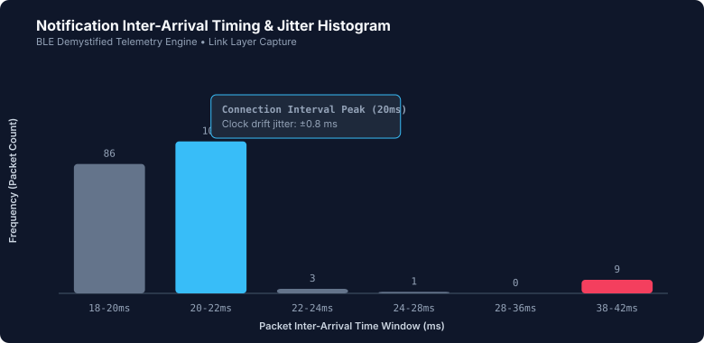

# BLE Demystified: How Bluetooth Low Energy Actually Works

An interactive, zero-hardware, beginner-friendly educational guide and live playground for Bluetooth Low Energy (BLE).

[](https://github.com)
[](LICENSE)
[](#quickstart)
[](https://nodejs.org)

Ever wondered how your fitness tracker or smartwatch whispers heart-rate readings to your phone without killing its battery before lunchtime? This repository breaks down the entire BLE protocol stack from radio waves to Web Bluetooth JavaScript, complete with a live browser demo, interactive visual explainer, and real RF telemetry plots.

---

## Architecture at a Glance


---

## Quickstart (3 Commands)

You do not need an ESP32, dongle, or special hardware. You only need Node.js:

```bash
# 1. Clone this repository
git clone https://github.com/example/ble-demystified.git
cd ble-demystified/simulator

# 2. Start the zero-dependency GATT simulator & web server
node server.js

# 3. Open your browser
# Web Bluetooth Client:    http://localhost:3333/web/
# Interactive Explainer:   http://localhost:3333/explainer/
```

Hit the **"▶ Run Full 6-Step Handshake"** button on the web demo to watch discovery, connection, reading battery, writing controls, and live heart rate streaming in action!

---

## Interactive Explainer (explainer/)

The repo includes a full, responsive interactive single-page app in `explainer/` with 7 interactive sections:

1. **What is BLE?**: Step through animated 2.4 GHz radio packets across advertising channels 37, 38, and 39 with Play/Pause controls.
2. **GAP States**: Clickable state machine (Standby, Advertising, Scanning, Initiating, Connected) showing power draw and transitions.
3. **GATT Explorer**: Interactive tree view of Services, Characteristics, and CCCD Descriptors with 16-bit vs 128-bit UUID inspection.
4. **Live Simulator & Tuner**: Tune connection interval (ms), MTU size, and RF interference sliders to observe real-time latency and estimated CR2032 battery lifespan.
5. **Read vs Write vs Notify**: Side-by-side visual playgrounds animating packets traveling between Central and Peripheral.
6. **Plots Gallery**: Inspection view of all generated telemetry plots with key takeaways.
7. **Interactive Quiz**: 5 multiple-choice questions with instant feedback and explanations.

---

## Visual Protocol Guide

### 1. GAP State Machine

*Standby (radio sleep) transitions to Advertising or Scanning, then to Connected via CONNECT_IND.*

### 2. BLE Protocol Layers

*Application and Profiles down through GATT, ATT, L2CAP, and Link Layer to the physical 2.4 GHz PHY.*

### 3. GATT Database Hierarchy

*Real service and characteristic hierarchy implemented in our simulator and ESP32 sketch.*

### 4. Connection & Subscription Sequence

*Step-by-step handshake from advertising packets to continuous notification streaming.*

### 5. Telemetry: RSSI vs. Time

*Shows natural +/- 4 dBm multipath fading even in stationary office environments.*

### 6. Telemetry: Jitter Histogram

*Sharp peak at the 20ms Connection Interval, with secondary retransmission tails.*

### 7. Telemetry: Throughput vs. ATT MTU

*Negotiating larger MTU sizes yields over 10x higher throughput with zero additional radio wakeups.*

---

## Optional Hardware Track: ESP32

Have an ESP32 board? You can flash our ready-to-use Arduino sketch:
1. Open `hardware/esp32/ble_peripheral.ino` in Arduino IDE or PlatformIO.
2. Select your ESP32 board and flash.
3. Switch the web client mode dropdown to **"📡 Real Web Bluetooth"** in Chrome or Edge, click **Scan**, and pair with your physical ESP32!

---

## Troubleshooting

- **Web Bluetooth Requirements:** Browser Web Bluetooth requires a secure context (`https://` or `http://localhost`) and must be triggered by a direct user gesture (clicking a button).
- **Supported Browsers:** Google Chrome, Microsoft Edge, Opera, or Chromium on Windows, macOS, Linux, and Android. (iOS Safari does not natively support Web Bluetooth; use Bluefy on iOS if testing real hardware).
- **Bluetooth Adapter:** Ensure your computer's Bluetooth radio is turned ON if testing real hardware mode. For simulated mode, no Bluetooth hardware or adapter is required!

---

## Project Roadmap
- [x] Zero-dependency simulated GATT server in Node.js
- [x] Dual-mode Web Bluetooth client (Real + Simulated)
- [x] Interactive 7-tab single-page educational explainer
- [x] Automated SVG plot and Mermaid diagram generation
- [x] ESP32 Arduino sketch for physical hardware track
- [ ] Add Environmental Sensing Service (0x181A) with temperature/humidity
- [ ] Add Web MIDI over BLE demo tab

---

## License
MIT License. Built for technical educators, hardware enthusiasts, and web developers everywhere!
